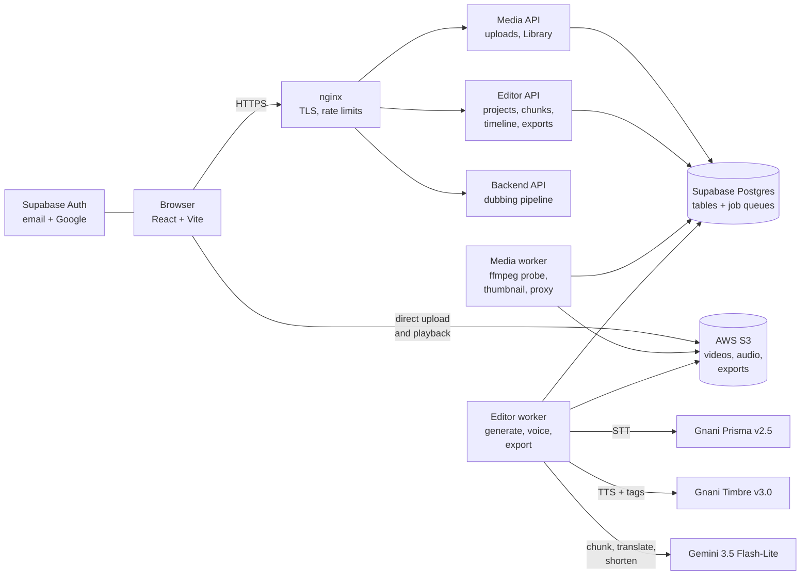

# Vani

**Your voice, in every Indian language.**

Vani is a web studio that dubs a video into another Indian language. It keeps each line on time
and carries the feeling of the original voice across. You upload a video, choose how it should be
voiced, and get back a dubbed video you can edit line by line, fine-tune on a timeline and export.

Live at <https://vani2.duckdns.org>.

---

## 1. The problem

Most of what is made in India is made in one language and watched in many. A teacher's lesson in
English, a news bulletin in Hindi, or a creator's video in Kannada reaches only the people who
speak that language. Dubbing it properly is slow and expensive. It needs translators, voice
artists, a studio and an editor, so most videos are never dubbed at all.

Machine dubbing tools exist, but they tend to fail in the same three ways:

- **Timing drifts.** The translated line is longer or shorter than the original, so the voice
  falls out of step with the picture, and the error grows over a long video.
- **The feeling is lost.** A laugh, a whisper or an excited line comes back flat and neutral.
- **There is no way to fix one line.** If one line is wrong, you redo the whole video.

Vani is built to fix all three.

## 2. Who will use it

| User | What they do with Vani |
|---|---|
| **Educators and course creators** | Take one recorded lesson into Kannada, Tamil, Hindi and more without re-recording. |
| **Newsrooms and explainer channels** | Put a bulletin out in several languages the same day, on time with the footage. |
| **YouTubers and independent creators** | Reach audiences beyond their own language with a voice that keeps their tone. |
| **NGOs and public-information teams** | Carry health, safety and government messages to people in their own language. |
| **Businesses** | Localise product demos, training and support videos for regional teams and customers. |

Users do not need audio or editing skills. The app does the work, and the editor is there to adjust
it.

## 3. Gnani AI models and APIs used

| Gnani model / API | Endpoint | What Vani uses it for |
|---|---|---|
| **Prisma v2.5, Batch STT** (`gnani-prisma-v2.5`) | `POST /stt/v3/batch/jobs`, then start, poll and fetch the results | Turns the video's speech into timestamped text. It can identify the language automatically (Hindi or English) and tell speakers apart. |
| **Timbre v3.0, TTS** (`timbre-v3.0`) | `POST /api/v1/tts/inference` | Speaks every translated line. Vani offers **13 voices**, and each one speaks every supported language. |
| **Timbre audio tags** | Sent inside the TTS text | Carry the feeling of each line, for example `excited`, `laugh`, `giggle`, `whispers`, `shouting`, `sigh`, `slow` or `pauses`. |
| **Voice clone** | `POST /api/v1/tts/voice-clone/embeddings`, then TTS with the embedding | Dubs in the original speaker's own voice from a 5–30 s sample, only with their consent. Built into the dubbing pipeline; the editor uses the 13 voices for now. |

**Not from Gnani:** Google **Gemini 3.5 Flash-Lite** splits the text into lines with an emotion
for each, translates every word, and shortens a line on request. Gemini sits behind one interface,
so it can be replaced.

Supported languages: Hindi, Tamil, Telugu, Kannada, Malayalam, Marathi, Bengali, Gujarati, Punjabi,
English and Hinglish.

## 4. High-level system architecture



**How a video becomes a dubbed video**

```
upload ─► Library (probe, thumbnail, 1280 px preview)
       ─► new project: video's own audio · a script · or your own narration
       ─► extract audio ─► (clean the narration) ─► Prisma v2.5 speech to text
       ─► Gemini: split into lines of 3–8 s, one emotion each ─► translate every word
       ─► place each line at its own start time
       ─► Timbre v3.0 speaks each line, with its emotion tag
       ─► edit lines · fine-tune on the timeline ─► export MP4 / WebM / MOV / MP3 / WAV
```

**Components**

| Part | Technology | Role |
|---|---|---|
| Frontend | React, Vite, served by nginx | Library, new-project flow, narration recorder, chunk editor, timeline editor, export. |
| Media service | FastAPI + worker | Signed direct-to-S3 uploads, then ffmpeg probe, thumbnail and preview proxy. |
| Editor service | FastAPI + worker | Projects, chunks, timeline, overlap fixes, exports. The worker runs the Gnani and Gemini pipeline and ffmpeg. |
| Database and queues | Supabase Postgres | All tables. Job queues use `SELECT … FOR UPDATE SKIP LOCKED`, so no Redis is needed. |
| Files | AWS S3 | Videos, previews, chunk audio, music and exports. The browser uploads and plays from S3 directly. |
| Auth | Supabase Auth | Email and password, and Google sign-in. |
| Hosting | AWS EC2, Docker Compose, Let's Encrypt | Six containers behind one nginx, over HTTPS. |
| CI/CD | GitHub Actions | Every push to `main` runs all test suites against a real Postgres, then deploys and health-checks. |

## 5. Highlights

**Timing that holds**
- **Every line is placed at its own start time.** Errors cannot add up, so the last line of a long
  video is as well-timed as the first.
- **Overlaps are shown and fixed on request.** When a line runs into the next one, Vani flags it.
  You choose to speed it up by exactly the amount needed, or have Gemini shorten the text.

**Feeling carries across**
- **One emotion per line.** Each line gets one of Timbre's audio tags (excited, laugh, whisper,
  sigh and more), and you can change it per line.
- **Three ways to start.** Dub the video's own audio, paste a script, or record your own narration
  in the browser.

**Edit one line, not the whole video**
- **Line-level editing.** Change a line's words, emotion or speed and only that line is voiced
  again. Lines can be split, merged and deleted.
- **A real timeline.** Video, original audio, voice, music and caption tracks. Trim, move, mute,
  duck and adjust volume, with undo and redo. Changes save as you go, and edits from two tabs
  are reconciled instead of overwriting each other.
- **Export with preview.** MP4, WebM, MOV, MP3 or WAV at 480p, 720p or 1080p. Captions can be an
  SRT or VTT file or burned into the video. Every export can be previewed before you download it.

**Careful with credits**
- **Gnani is never called twice for the same thing.** Every result is stored under a key made from
  its text, voice, language, emotion and speed, so a repeat costs nothing.
- **Speed changes are free.** Gnani is always called at 1.0×. Any speed change is applied with
  ffmpeg to the stored take, so changing speed never makes a new paid call.
- **Fair rate limits.** Gnani and Gemini budgets are shared fairly between the users active at
  that moment. Gemini spreads its calls across several API keys within each key's per-minute,
  per-token and per-day limits.

**Built to be trusted**
- **No silent failures.** Every job records its state, error code and message, and the app shows
  every failure with a way to retry.
- **No stale audio.** A line's audio is saved only if the line hasn't been edited since it was
  requested.
- **Free development mode.** With fake providers, the whole pipeline, including timing and ffmpeg
  mixing, runs locally without spending any credits.
- **Responsible use.** Only videos you own, and only voices whose owners consent to cloning.
  Cloned output is labelled as AI-generated.

## 6. Limits today

- **No lip sync.** Mouths will not match the new language.
- **Subtle emotion.** Clear emotions carry over; sarcasm and irony mostly do not.
- **Not real time.** Vani is an upload-and-wait tool, not live dubbing.
- **Original audio is lowered, not separated.** Music and background sound are ducked or muted
  under the dub, not removed.

---

Built by Mithravardhan and Arko.
