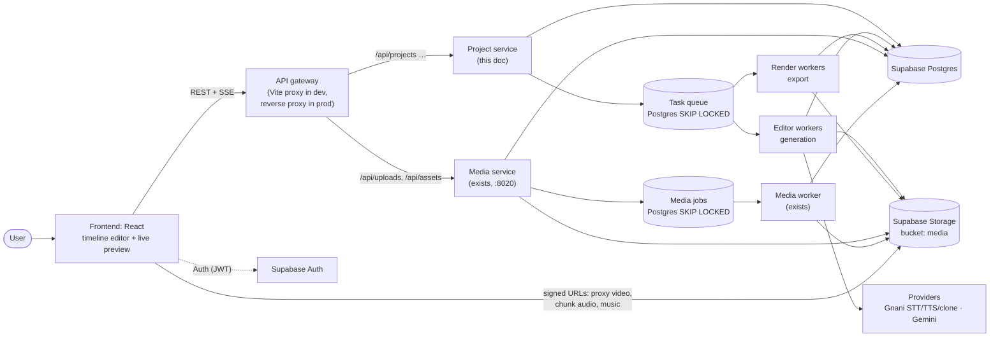
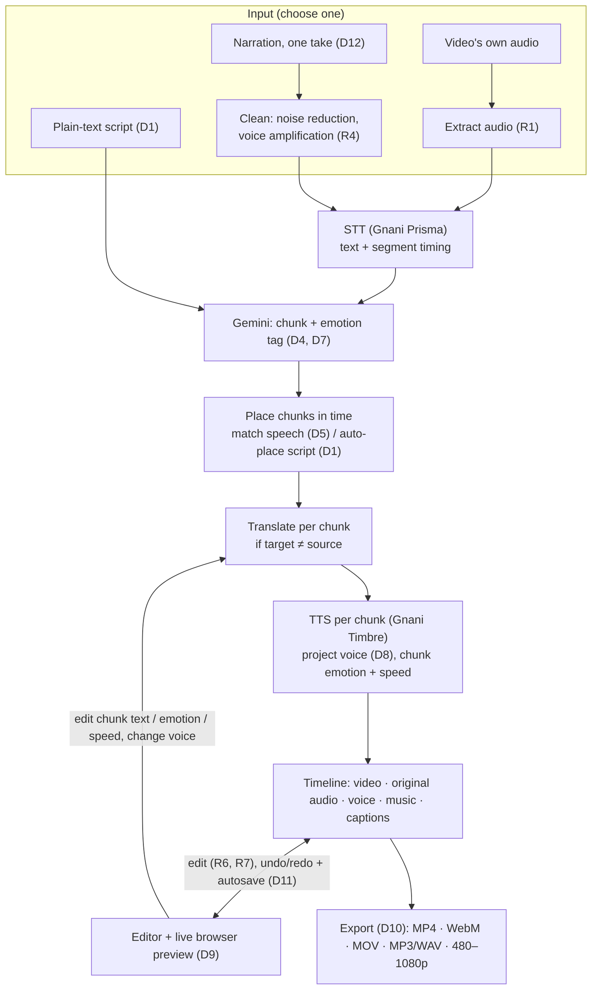
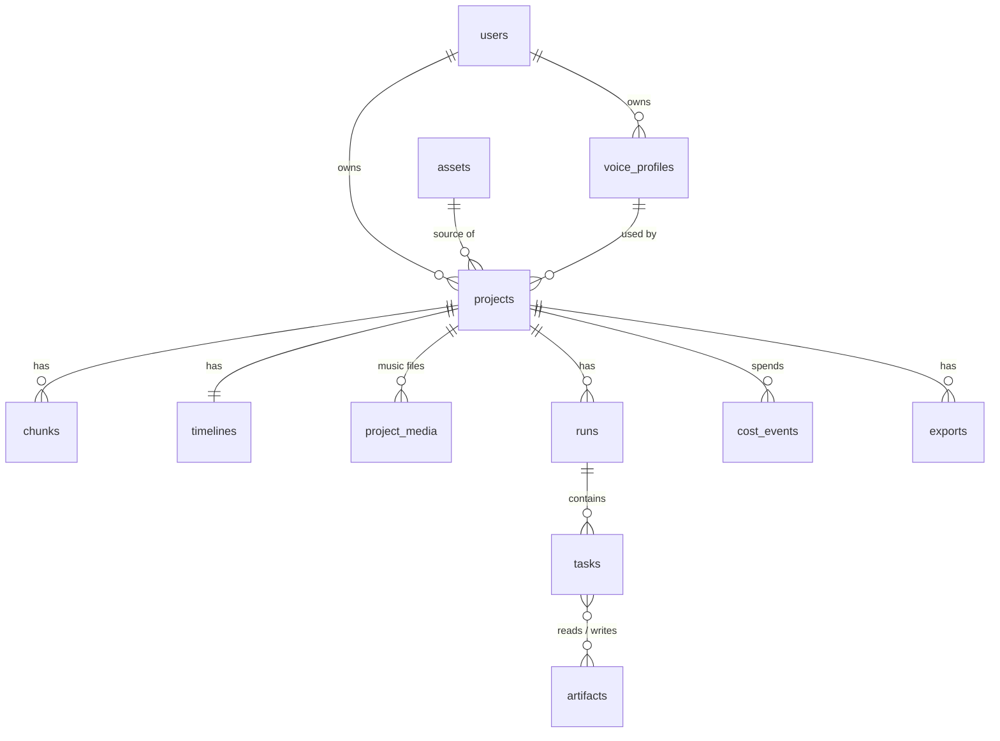
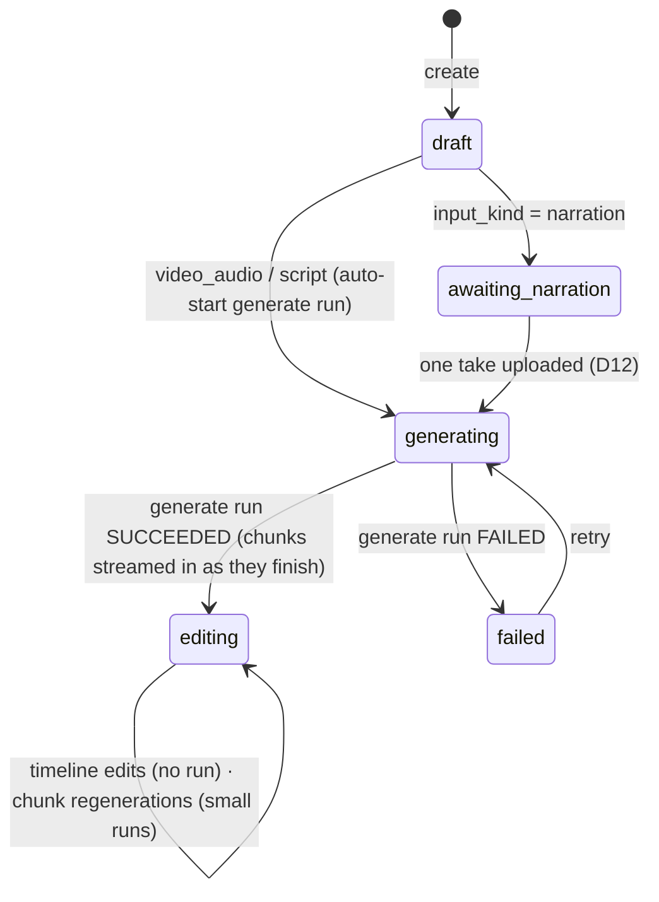
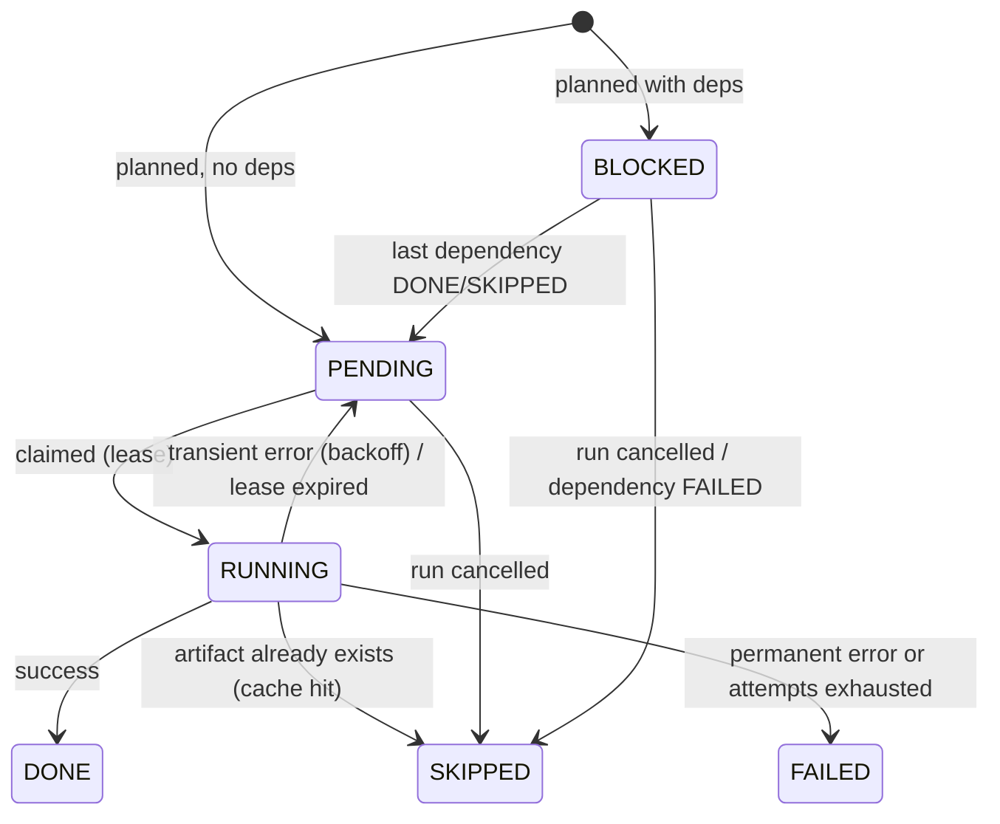
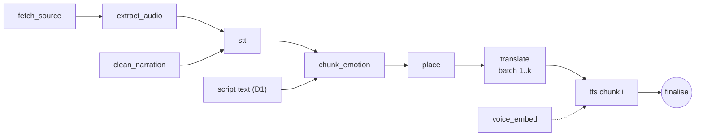

# Project & Editor Services: System Design

**Status:** revision 2 (aligned to [`editot.txt`](../../editot.txt) and the 12 Oct decisions) · for review by Mithravardhan and Arko · **Date:** 12 Oct 2026
**Scope:**
- The *Project service*: projects, inputs, lifecycle, ownership.
- The *Editor service*, in two parts:
  - the **generation pipeline**: input → text → Gemini chunks + emotion → translation → TTS per chunk;
  - the **timeline editor**: multi-track video/voice/music/captions, previewed live in the browser.
- The *Export service* as far as it renders the timeline.

**Out of scope:** authentication and the Library upload pipeline (`media_service/`), except where projects use them.

**Markers:**
- **[exists]** is in today's code.
- **[changed]** exists today but this design changes it.
- **[new]** is proposed.
- **⚠ DECIDE** marks an item that needs an answer before it's built, collected in §11 *Open decisions*. Nothing marked ⚠ is assumed elsewhere.

---

## Contents

0. [Requirements and decisions](#0-requirements-and-decisions)
1. [Goals and non-goals](#1-goals-and-non-goals)
2. [High-level design](#2-high-level-design)
3. [Core concepts](#3-core-concepts)
4. [Low-level design: data model](#4-low-level-design-data-model)
5. [Low-level design: state machines](#5-low-level-design-state-machines)
6. [Low-level design: the generation pipeline](#6-low-level-design-the-generation-pipeline)
7. [Low-level design: APIs and events](#7-low-level-design-apis-and-events)
8. [Cross-cutting concerns](#8-cross-cutting-concerns)
9. [Migration plan from today's code](#9-migration-plan-from-todays-code)
10. [Timeline editor, live preview and export](#10-timeline-editor-live-preview-and-export)
11. [Open decisions (⚠ DECIDE)](#11-open-decisions--decide)

---

## 0. Requirements and decisions

### 0.1 Requirements (from `editot.txt`)
| # | Requirement |
|---|---|
| R1 | Extract the audio of the video. |
| R2 | **Video audio path:** STT → translate to the preferred language → emotions via Gemini → TTS in the selected language and voice. The voice can be changed at any time; switching language is a future item. |
| R3 | **Script path:** the uploaded script → translation if required → emotions via Gemini → TTS in the selected language and voice. The voice can be changed at any time. |
| R4 | **Narration path:** record → audio processing (noise reduction, voice amplification) → STT → the same as R2. |
| R5 | Speech text is broken into **small chunks** so the user can adjust emotion and speed and edit the text. **Gemini produces the chunks**, cut for natural voice modulation. |
| R6 | Trim, split, merge, audio overlap and other video/audio editing. |
| R7 | **Separate video and audio tracks on a timeline.** |
| R8 | Download in **multiple formats and resolutions**. |

### 0.2 Decisions (answered 12 Oct)
| # | Question | Decision |
|---|---|---|
| D1 | What is an uploaded script? | **Plain text**, auto-placed on the timeline by Vani; the user then adjusts positions. |
| D2 | How far does editing go? | **Full multi-track editor.** The video track can be **trimmed, split, cut and reordered**; chunks attached to removed video are removed too, and the final length follows the edited video. |
| D3 | What do extra tracks hold? | **Music/audio files**, and **captions** generated from the chunk text (as an option). No extra videos or images. |
| D4 | Where do chunks come from? | STT provides the **text**. **Gemini** reads it, cuts it into chunks of a preferred size so the voice sounds human, and adds an **emotion tag from the list Gnani's TTS supports**. |
| D5 | Where does a chunk sit in time (video-audio path)? | **Matched to the original speech** using STT timing, then freely adjustable by the user. |
| D6 | Chunk audio longer than the space before the next chunk? | **Allowed to overlap; the chunk is flagged with a warning.** No automatic squeezing. |
| D7 | Emotion source | **Gemini only** (text). The acoustic analysis (pitch, loudness, pace) is removed. |
| D8 | Voice granularity | **One voice per project**, changeable at any time; changing it re-voices every chunk. |
| D9 | Preview | **Live in the browser**; the server renders only on export. |
| D10 | Export | **MP4 (H.264), WebM, MOV, audio-only (MP3/WAV); 480p, 720p, 1080p.** |
| D11 | Edit history | **Undo/redo + autosave.** No named versions. |
| D12 | Narration capture | **One continuous take** at a chosen start point → cleaned → STT → chunked → placed at its recording time. |

### 0.3 The two loops (the core idea of this revision)
| | **Generation loop** (slow, paid, server) | **Editing loop** (instant, free, browser) |
|---|---|---|
| What | Input → STT → Gemini chunks + emotion → translation → TTS per chunk | Cut, trim, split, move, overlap, volumes, captions on/off |
| Triggered by | Creating a project; editing a chunk's **text, emotion or speed**; changing the **voice** | Any timeline operation |
| Cost | Credits; seconds to minutes | Nothing; milliseconds |

**Principle:** *the timeline never calls an AI provider.* It only arranges audio the generation loop has produced. Editing a chunk's content regenerates **that chunk only**, and the new audio swaps into its clip in place.

---

## 1. Goals and non-goals

### Goals
| # | Goal | Why it matters |
|---|---|---|
| G2 | **Incremental generation.** Editing a chunk's text, emotion or speed regenerates only that chunk's audio. | Every TTS/translation call costs credits and time. |
| G3 | **Crash-safe, resumable runs.** A worker crash or restart never loses or duplicates paid work. | Long jobs (minutes), paid APIs, Windows dev machines. |
| G4 | **Export matches preview.** The exported file is sample-accurate to the timeline the user previewed. | Vani's core promise. |
| G8 | **Instant editing.** Timeline operations never call providers and update the preview within 50 ms. | Editing must feel like a video editor (R6, R7). |
| G5 | **Start from the Library.** Projects use an asset already uploaded to the media service; video bytes never pass through the API twice. | Avoids re-uploads; one source of truth for files. |
| G6 | **Observable.** Every run, task, provider call and credit spend is traceable. | Debugging and the hackathon credit budget. |
| G7 | **Scales out by adding workers**, not by rewriting. | One machine today, more later. |

### Non-goals (for now)
- Real-time collaboration (two people editing one project at once). Projects are single-owner.
- Lip sync, music separation (PLAN §2).
- Multi-region or high availability. One Supabase project, one region.
- Extra video or image clips on the timeline (D3); named versions (D11); switching language within a project (R2 "future item").

---

## 2. High-level design

### 2.1 Context



### 2.2 Responsibilities

| Component | Owns | Does not own |
|---|---|---|
| **Project service** (API process) | Project records, settings, chunk content edits, timeline documents and operations, validation, ownership checks, planning and cancelling runs, serving media URLs, progress events | Doing any heavy work (no ffmpeg, no provider calls in the request path) |
| **Editor workers** (separate processes) | Generation tasks: audio extraction, narration cleanup, STT, Gemini chunking + emotion, translation, per-chunk TTS | Deciding *what* to run; rendering exports |
| **Render workers** (separate processes; may be the same binary) | Export tasks: rendering the timeline to the requested format and resolution (§10.5) | Calling AI providers |
| **Browser editor** | Timeline operations, undo/redo, autosave, live preview (§10) | Persisting anything except through the API |
| **Media service** (exists) | Uploads, assets, thumbnails, preview proxies | Projects |
| **Postgres** | All state: projects, chunks, timelines, runs, tasks, artifacts index, exports, cost ledger | Large binary data |
| **Storage** | All files: sources, intermediate audio, outputs, subtitles | Metadata |

**Design principle:** *the API plans, workers execute, Postgres is the single source of truth.* Workers are stateless apart from a local scratch directory they can lose at any time.

### 2.3 How a project flows (one picture) [changed]



There's one **generation run** per project, which produces chunks and their audio. After that, **chunk-level regenerations** run as small runs (one chunk's TTS, or one translation batch plus TTS). Timeline edits never start a run (§0.3). Export is a separate **export run** over a timeline snapshot (§10.5).

### 2.4 Key decisions

| Decision | Choice | Alternatives considered | Reason |
|---|---|---|---|
| Queue | **Postgres `SKIP LOCKED`** table, the same pattern as `media_service` | Redis/RQ, Celery, in-process asyncio (today) | Already proven in this repo; transactional with project state; no new infrastructure. Redis can be added later for rate limiting only. |
| Unit of work | **Task per (stage, chunk)** for TTS; one task for whole-project stages | One job per project (today) | Enables incremental edits (G2), parallelism and fine-grained retries. |
| Editing | **Timeline document + operations**, applied in the browser and autosaved | Server-side rendering per edit | Instant editing (G8) with no provider calls; the server renders only on export (D9). |
| Reuse | **Content-addressed artifacts**: key = hash(inputs) | Timestamps / dirty flags | Correct by construction: same inputs means the same output, so a cache hit is always valid. |
| State of a project | **Normalised tables** (projects, chunks, timelines, runs, tasks, artifacts) | One `jsonb` document (today) | Concurrent workers can't safely rewrite one big document; per-chunk rows can be updated independently. |
| Files | **Supabase Storage**, key prefix `{user_id}/projects/{project_id}/…` | Local `storage/` (today) | Stateless workers; any worker can pick up any task. |
| Progress to browser | **SSE fed by Postgres `LISTEN/NOTIFY`** | Polling; Supabase Realtime | Works across many API processes; SSE client already exists. |

---

## 3. Core concepts

| Concept | Meaning |
|---|---|
| **Project** | One user's work on one source video. Has an **input kind** (`video_audio` \| `script` \| `narration`), languages, **one voice** (D8), and **one timeline**. |
| **Source** | The video the project is built from: a Library **asset** (`assets.id`). Its proxy is used for preview, its original for export. Narration adds a **recording**; script adds **plain text**. |
| **Chunk** [new, replaces "segment"] | A Gemini-cut piece of speech text: `source_text`, `text` (target language), `emotion_tag`, `speed`, an **anchor** in source-video time, and its current **audio version**. |
| **Timeline** [new] | The edit document: tracks (`video`, `original_audio`, `voice`, `music`, `captions`) of clips (§10.1). |
| **Run** | One execution of generation work: `generate` (whole project), `regenerate` (some chunks) or `export`. A project has at most one active generation run; export runs are independent. |
| **Task** | One unit of work in a run, e.g. `tts(chunk 12)` or `chunk_emotion`. Tasks form a DAG. |
| **Artifact** | Any output of a task (a transcript JSON, a WAV clip, the MP4), stored in Storage and indexed in Postgres by **content key**. |
| **Content key** | `sha256` of everything that determines an artifact: input artifact keys, settings, model/version, code version of the stage. |
| **Voice profile** | A consented voice clone embedding, owned by a user, reusable across projects. |

---

## 4. Low-level design: data model

### 4.1 Entity-relationship



### 4.2 Tables

All tables have RLS enabled with "owner can select own rows". Services use the secret key server-side; every query still filters by `owner_id` explicitly (defence in depth, see §8.1).

**`projects`** [exists as a jsonb document; normalised here]
| Column | Type | Notes |
|---|---|---|
| `id` | `uuid` PK | was `text` (12 hex chars) |
| `owner_id` | `uuid` FK → `users.id` | **not null**, indexed |
| `asset_id` | `uuid` FK → `assets.id` | source video [new] |
| `input_kind` | `text` | `video_audio` \| `script` \| `narration` [changed: replaces `mode`] |
| `script_text` | `text` null | plain-text script (D1) |
| `narration_artifact` | `text` | content key of the **cleaned** narration WAV (D12, R4) |
| `narration_offset_s` | `numeric(10,3)` | where the take starts in source time |
| `name` | `text` | 1–120 chars |
| `src_lang`, `tgt_lang` | `text` | `tgt_lang` may equal `src_lang`; changing it after creation is ⚠ §11-C7 |
| `voice` | `jsonb` | **one voice per project** (D8): `{mode: persona\|clone, voice_id?, voice_profile_id?}` (clone ⚠ §11-C15; own recorded voice ⚠ §11-C14) |
| `duration_s` | `numeric(10,3)` | from the asset probe |
| `status` | `text` | §5.1 |
| `active_run_id` | `uuid` null | at most one active generation run |
| `settings_version` | `int` | bumped on voice/language changes; optimistic lock |
| `timeline_version` | `int` | mirrors `timelines.version` |
| ~~`bg_mode`, `output`, `stats`~~ | | removed [changed]: background level is now `original_audio` track gain/auto-duck (§10.1); outputs are `exports` rows |
| `created_at`, `updated_at`, `deleted_at` | `timestamptz` | soft delete |

**`chunks`** [new: replaces today's `segments` inside `projects.data`]
| Column | Type | Notes |
|---|---|---|
| `id` | `uuid` PK | |
| `project_id` | `uuid` FK | indexed with `idx` |
| `owner_id` | `uuid` | denormalised for RLS and fast ownership checks |
| `idx` | `int` | order in the transcript; unique per project |
| `source_text` | `text` | Gemini-cut span of the transcript/script (**editable**) |
| `char_start`, `char_end` | `int` | span in the transcript (§6.3a) |
| `text` | `text` | target-language text (= `source_text` when there's no translation); **editable** |
| `anchor_src_s`, `anchor_len_s` | `numeric(10,3)` null | anchor in source-video time (§6.3b); null until a script chunk is placed |
| `emotion_tag` | `text` | from Gnani Timbre's supported tag list or `neutral` (D4); **editable** |
| `speed` | `numeric(4,3)` | per-chunk, **editable**, 0.85–1.15 (⚠ §11-C5) |
| `audio_key`, `audio_duration_s` | `text`, `numeric(10,3)` | current audio version (artifact) |
| `status` | `text` | `pending` · `generating` · `ready` · `failed` |
| `revision` | `int` | bumped on every content edit (optimistic lock) |

Removed from today's segment model [changed]: `acoustic`, `intensity`, `nonverbal`, `emotion_overridden` (D7); `keep_original` (the original audio is now its own track); `slot_end_s` and fit stats (D6).

**`timelines`** [new]: `project_id` PK, `owner_id`, `version int`, `doc jsonb` (§10.1), `updated_at`.
**`timeline_ops`** [new]: append-only `(project_id, version, ops jsonb, created_at)`, for audit and recovery; trimmed after N versions.
**`project_media`** [new]: music/audio files on a project: `id, project_id, owner_id, storage_key, filename, duration_s, created_at` (⚠ §11-C11).
**`exports`** [new]: `id, project_id, owner_id, timeline_version, format, resolution, audio_only, captions_mode, status, output_key, error, created_at, finished_at`.

**`runs`** [new]
| Column | Type | Notes |
|---|---|---|
| `id` | `uuid` PK | |
| `project_id`, `owner_id` | `uuid` | |
| `kind` | `text` | `generate` \| `regenerate` \| `export` [changed: was `analyze` \| `render`] |
| `status` | `text` | `PLANNED` → `RUNNING` → `SUCCEEDED` \| `FAILED` \| `CANCELLED` |
| `settings_version` | `int` | the project settings this run was planned against |
| `progress` | `jsonb` | `{stage: {done, total}}` for the UI |
| `error` | `text` | user-facing message |
| `created_at`, `started_at`, `finished_at` | `timestamptz` | |

**`tasks`** [new: the queue]
| Column | Type | Notes |
|---|---|---|
| `id` | `uuid` PK | |
| `run_id`, `project_id`, `owner_id` | `uuid` | |
| `stage` | `text` | §6.1 |
| `chunk_id` | `uuid` null | null for whole-project stages |
| `content_key` | `text` | the artifact this task produces |
| `status` | `text` | `BLOCKED` → `PENDING` → `RUNNING` → `DONE` \| `FAILED` \| `SKIPPED` |
| `deps_remaining` | `int` | becomes `PENDING` at 0 |
| `attempts`, `max_attempts` | `int` | |
| `priority` | `int` | lower runs first (whole-project stages > chunk stages; user-triggered regenerations > bulk voice changes) |
| `run_after` | `timestamptz` | backoff |
| `lease_until` | `timestamptz` | worker heartbeat; expired leases are requeued |
| `worker_id` | `text` | |
| `last_error`, `error_class` | `text` | `transient` \| `permanent` \| `provider_quota` |
| unique | | `(run_id, stage, chunk_id)` |

**`task_deps`** [new]: `(task_id, depends_on_task_id)`, both FK to `tasks`.

**`artifacts`** [new: replaces today's local `cache` table]
| Column | Type | Notes |
|---|---|---|
| `content_key` | `text` PK | sha256 hex |
| `owner_id` | `uuid` | artifacts are **per-owner**: never shared across users, even with identical inputs |
| `kind` | `text` | `stt_json`, `chunks_json`, `translation_json`, `chunk_wav`, `narration_clean_wav`, `export` |
| `storage_key` | `text` | `{owner_id}/artifacts/{kind}/{content_key}.{ext}` |
| `bytes` | `bigint` | |
| `meta` | `jsonb` | e.g. `{duration_s, sample_rate}` |
| `created_at`, `last_used_at` | `timestamptz` | for garbage collection |

**`voice_profiles`** [new]: `id, owner_id, name, embedding (jsonb), source (video|upload|record), consent_at, consent_text, created_at, deleted_at`.

**`cost_events`** [new]: `id, owner_id, project_id, run_id, task_id, provider, operation, units, unit, credits_estimate, cache_hit (bool), created_at`.

### 4.3 Storage layout

```
media/                                  (bucket, private)
  {owner_id}/{asset_id}/source.mp4      (media service, exists)
  {owner_id}/{asset_id}/proxy.mp4       (media service, exists)
  {owner_id}/projects/{project_id}/narration.wav
  {owner_id}/projects/{project_id}/music/{media_id}.{ext}
  {owner_id}/artifacts/{kind}/{content_key}.{ext}     (STT json, chunk list, chunk wav, …)
  {owner_id}/exports/{export_id}.{ext}
```
Signed URLs only (TTL ≤ 1 h), never stored in the database.

---

## 5. Low-level design: state machines

### 5.1 Project status


[changed: `analyzing`/`review`/`rendering`/`done` collapse into `generating` and `editing`.]

Rules:
- **`editing` is the steady state.** Timeline operations are always allowed in it and never start a run (§0.3).
- **Chunk content edits** (text, emotion, speed) start a small `regenerate` run for that chunk. Other chunks and the timeline stay editable meanwhile; only the edited chunk shows "updating…".
- **Voice change** (D8) starts a `regenerate` run for every chunk (estimate first, §8.5). The timeline stays editable; chunks swap audio as they finish.
- **Exports** are independent runs over a timeline snapshot and don't lock anything.
- During `generating`, the timeline can be opened and edited as chunks arrive; content edits to a chunk still generating return **409**.
- Status changes happen **only** in the Project service or the run-finaliser, inside a transaction with the run row.

### 5.2 Task status



A run finishes when no task is `BLOCKED`/`PENDING`/`RUNNING`. It **SUCCEEDED** if every non-optional task is `DONE`/`SKIPPED`, otherwise it **FAILED**, with the first permanent error copied to `runs.error`.

---

## 6. Low-level design: the generation pipeline

### 6.1 Stages [changed]

| Stage | Scope | Inputs | Output artifact | Provider | Status |
|---|---|---|---|---|---|
| `fetch_source` | project | asset `storage_key` | (local scratch) | none | [new]: from the Library asset |
| `extract_audio` | project | source | `stt16.wav` | ffmpeg | [exists] (R1) |
| `clean_narration` | project | one take | `narration_clean_wav` | ffmpeg: noise reduction + amplification | [changed]: today an "own voice" filter; now always before STT (R4) |
| `stt` | project | `stt16` or cleaned narration + `src_lang` | `stt_json` (text + segment timing) | Gnani Batch STT 💳 | [exists] |
| `chunk_emotion` | project | transcript or script text, allowed tags, chunk size | `chunks_json` | **Gemini** 💳 | [new] (D4, D7) |
| `place` | project | chunks + STT timing / script rule | chunk anchors | none | [new] (D5, D1) |
| `translate` | batch of ≤ 20 chunks | chunk texts + neighbours as context | `translation_json` | Gemini 💳 | [changed]: per chunk, no length budget |
| `voice_embed` | project | consented reference | voice profile | Gnani clone 💳 | [exists] (⚠ §11-C15) |
| `tts` | **chunk** | text, project voice, lang, `emotion_tag`, `speed` | `chunk_wav` | Gnani Timbre / clone 💳 | [changed]: per chunk, user speed |

**Removed** [changed]: `normalise` (Gemini chunks replace STT-segment lines), `acoustic` and `fuse_emotion` (D7), and `fit`, `assemble`, `mux` and `subtitles` from generation. Timing is arranged by the timeline, and rendering happens only at export (§10.5). Automatic speed-up/short-retry/borrow fitting is replaced by overlap flags (D6).

### 6.2 Run plans (DAGs)

**Generate run** (one per project):

- **video_audio:** `fetch_source → extract_audio → stt → chunk_emotion → place → translate → tts`.
- **script:** `chunk_emotion → place (auto) → translate → tts`. There's no STT. The `place` step for scripts needs each chunk's audio duration, so script placement runs **after** `tts` (⚠ §11-C2 for the rule).
- **narration:** `clean_narration → stt → chunk_emotion → place (+ recording offset) → translate → tts`.
- `translate` is skipped when `tgt_lang == src_lang`.

**Regenerate run** (chunk content edit or voice change): `translate(batch)` only when the source text changed, then `tts(chunk)` for each affected chunk.

### 6.3a Chunking with Gemini [new] (D4, D7)
- **Request:** the transcript or script, the language, the **allowed emotion tags** (Gnani Timbre v2.5 audio tags), and the **preferred chunk size** (⚠ §11-C1). Structured JSON output: `[{text, emotion_tag}]`.
- **Validation** (our code; Gemini is never trusted blindly):
  1. Concatenated chunk texts must equal the input after whitespace normalisation. Gemini may only **cut**, never rewrite. Otherwise retry once, then fall back to sentence splitting.
  2. Every `emotion_tag` must be in the allowed list, else `neutral`.
  3. Chunks outside the size bounds are re-split at the nearest sentence/comma boundary.
- **Result:** chunks with exact character spans `[char_start, char_end)` in the transcript.

### 6.3b Placing chunks in time [new] (D5, D1)
- **video_audio / narration: match the original speech.**
  - STT gives **segment-level** timing only (no word timings).
  - A chunk's start/end = the time of `char_start`/`char_end`, **linearly interpolated by character position** inside the STT segment containing that character; narration adds its recording offset.
  - The result is the anchor `(anchor_src_s, anchor_len_s)` in source-video time.
  - *Precision:* boundaries that coincide with STT segment boundaries are exact; boundaries inside a segment are estimates. The user corrects them by dragging (D5).
- **script: auto-place** (D1), using the rule in ⚠ §11-C2.

### 6.3 Content keys (what makes a cache hit valid)

Each stage defines its key from **every** input that can change its output, plus a **stage version** constant bumped whenever its code changes behaviour.

```
key(stt)           = H("stt",           v1, sha(stt input wav), src_lang, "prisma-v2.5")
key(chunk_emotion) = H("chunk_emotion", v1, LLM_MODEL, sha(transcript or script), lang, allowed_tags, chunk_size)
key(translate)     = H("translate",     v4, LLM_MODEL, src, tgt, [ {chunk_id, source_text, emotion_tag, ctx_before, ctx_after} ... ])
key(tts)           = H("tts",           v3, text, voice_id | voice_profile.embedding_hash, tgt, emotion_tag, round(speed, 3))
key(export)        = H("export",        v1, timeline_version, [chunk audio keys], [music keys], format, resolution, audio_only, captions_mode)
```

What each change re-runs:
| Change | Re-runs | Cost |
|---|---|---|
| Edit a chunk's **source text** | translation of that chunk's batch, then that chunk's TTS | 1 LLM + 1 TTS |
| Edit a chunk's **target text** | that chunk's TTS | 1 TTS |
| Change a chunk's **emotion** or **speed** | that chunk's TTS | 1 TTS |
| Change the **voice** (D8) | TTS for **every** chunk (estimate first, §8.5) | N TTS |
| Undo any of the above | **nothing**: the previous key's audio is still cached (G2) | 0 |
| Any timeline operation | **nothing** (G8) | 0 |

Keys are **per owner**, so two users never share cached audio.

> Batch translation reuse could be finer (per-line keys with the batch as context), but context sensitivity makes per-line caching subtle. Batch-level is correct and simple; revisit if translation cost matters.

### 6.4 Planning a chunk regeneration (Project service, one transaction)

```
plan_regenerate(project, chunk_ids, reason):           # reason: content_edit | voice_change | retry
    lock project row (SELECT … FOR UPDATE)
    run = insert runs(kind=regenerate, status=PLANNED, settings_version)
    for each affected translate batch (only if a source_text changed and tgt ≠ src):
        t_b = add_task(translate, content_key=key(translate, batch))
    for each chunk c in chunk_ids:
        add_task(tts, chunk=c, content_key=NULL (late-bound), deps=[t_b?, t_voice?])
        c.status = generating
    mark SKIPPED any task whose artifact already exists (e.g. undo to a cached version)
    promote ready tasks; NOTIFY project_events, project.id
```
**Late binding:** a `tts` key depends on the translation *output*, so it's computed when the task is claimed, once its dependencies are done. On a cache hit the task is `SKIPPED` and the chunk points at the existing audio.

**Stale-result guard:** when a `tts` task completes, the chunk's `audio_key` is updated **only if** the task's key still equals the key of the chunk's *current* inputs (text, voice, emotion, speed). If the user has edited the chunk again since, the result is kept as cache but not attached.

The **generate** run is planned the same way, with the full DAG of §6.2.

### 6.5 Worker loop

```
loop:
    reap: requeue tasks where status=RUNNING and lease_until < now()          (every 30 s)
    task = claim():
        UPDATE tasks SET status=RUNNING, attempts=attempts+1, worker_id=$me,
               lease_until = now() + interval '2 min'
        WHERE id = (SELECT id FROM tasks
                    WHERE status='PENDING' AND run_after <= now()
                    ORDER BY priority, created_at
                    FOR UPDATE SKIP LOCKED LIMIT 1)
        RETURNING *
    if none: sleep(poll); continue

    heartbeat every 30 s: UPDATE tasks SET lease_until = now()+2min WHERE id=$id AND worker_id=$me
    if task.content_key is NULL: compute it now from DONE deps
    if artifact(content_key) exists and owner matches → complete(task, SKIPPED)
    else:
        with scratch dir:
            inputs  = fetch input artifacts (Storage → local, via signed URL, streamed)
            output  = STAGE[task.stage].run(inputs, settings)
            upload output → Storage; INSERT artifacts ON CONFLICT DO NOTHING
            record cost_event (provider stages)
        complete(task, DONE)

complete(task, outcome)  -- one transaction:
    UPDATE tasks SET status=outcome, lease_until=NULL …  WHERE id=$id AND worker_id=$me
         -- the worker_id guard: a worker whose lease was stolen can't overwrite the new owner
    write derived fields (e.g. chunks.audio_key / text, subject to the stale-result guard in §6.4)
    UPDATE tasks SET deps_remaining = deps_remaining-1 WHERE id IN (dependents);
    UPDATE tasks SET status='PENDING' WHERE id IN (dependents) AND deps_remaining=0
    update runs.progress;  if no open tasks → finalise run (+ project status, output)
    NOTIFY project_events, project_id
```
**Error classes:**
| Class | Examples | Behaviour |
|---|---|---|
| `transient` | network error, 5xx, timeout | retry with backoff 15 s · 60 s · 4 min (max 4 attempts) |
| `provider_quota` | 429, 402/403 "out of credits" | pause **all** tasks for that provider for `Retry-After` (or 5 min); doesn't burn attempts; surface in UI |
| `permanent` | 400 bad input, unreadable media, policy refusal | fail now; run fails with a readable message |

**Concurrency:** each worker runs `N` slots (default 3 TTS-bound + 1 ffmpeg-bound). A per-provider semaphore stored in Postgres (`provider_slots`) caps concurrent Gnani calls across all workers (e.g. 4), which avoids 429 storms.

### 6.6 Content edits vs timeline edits

| Edit | Kind | Effect |
|---|---|---|
| Chunk source/target text, emotion tag, speed (R5) | **content** | `UPDATE chunks … WHERE id=$1 AND revision=$2` (else **409**); `revision++`; `regenerate` run for that chunk (§6.4) |
| Voice (D8) | **content** (project-wide) | `settings_version++`; `regenerate` run for every chunk |
| Target language | **content** | ⚠ §11-C7 (R2 says language switching is a future item) |
| Trim, split, merge, move, overlap, cut video, volumes, music, captions | **timeline** | Timeline operations (§10.2); no run |
| Retry a failed chunk | content | `regenerate` run for that chunk |
| Cancel | | run → `CANCELLED`; open tasks → `SKIPPED`; running tasks' artifacts are kept as cache |
| Delete project | | soft delete; active runs cancelled; artifacts garbage-collected later (§8.6) |

---

## 7. Low-level design: APIs and events

All endpoints require `Authorization: Bearer <jwt>` (or `?access_token=` for media/SSE). Every lookup is `WHERE id=$1 AND owner_id=$user`, and a project that isn't yours returns **404**, never 403.

### 7.1 Projects

| Method & path | Body | Returns | Errors |
|---|---|---|---|
| `POST /api/projects` | `{asset_id, name?, input_kind, src_lang, tgt_lang, voice, script_text?}` + `Idempotency-Key` | project; starts the generate run (except narration) | 404 asset not yours · 409 asset not READY · 400 validation |
| `GET /api/projects?status=&q=&cursor=` | | `{items, next_cursor}` | |
| `GET /api/projects/{id}` | | project + chunk counts by status | 404 |
| `PATCH /api/projects/{id}` | `{name?, voice?}` + `If-Match: <settings_version>` | project; a voice change starts a regenerate run (estimate first) | 409 version mismatch |
| `DELETE /api/projects/{id}` | | `{ok}` | 404 |
| `POST /api/projects/{id}/narration` | multipart `audio` (one take), `offset_s` (D12) | project | 409 wrong input kind/status |

### 7.2 Chunks (content edits → regeneration) [new]

| Method & path | Body | Returns |
|---|---|---|
| `GET /api/projects/{id}/chunks` | | `[chunk]` with signed audio URLs |
| `PATCH /api/projects/{id}/chunks/{chunk_id}` | `{source_text?, text?, emotion_tag?, speed?}` + `If-Match: <revision>` | chunk (`status: generating`); 409 on a stale revision |
| `POST /api/projects/{id}/chunks/{chunk_id}/regenerate` | | chunk |
| `GET /api/projects/{id}/estimate?change=voice` | `{voice}` | `{tts_calls, cache_hits}` for the confirm dialog |

### 7.3 Timeline [new]

| Method & path | Body | Returns |
|---|---|---|
| `GET /api/projects/{id}/timeline` | | `{version, doc}` |
| `POST /api/projects/{id}/timeline/ops` | `{base_version, ops[]}` | `{version}`, or **409** + `{version, doc}` on conflict (§10.3) |
| `POST /api/projects/{id}/media` | multipart audio file (⚠ §11-C11) | `{media_id, duration_s, url}` |
| `GET /api/projects/{id}/source` | | `302` to the asset's preview proxy (for live preview) |

### 7.4 Exports [new]

| Method & path | Body | Returns |
|---|---|---|
| `POST /api/projects/{id}/exports` | `{timeline_version, format, resolution, audio_only?, captions_mode?}` | export (`202`) |
| `GET /api/projects/{id}/exports` | | list |
| `GET /api/projects/{id}/exports/{export_id}` | | status + signed download URL when done |

### 7.5 Events (SSE)

`GET /api/projects/{id}/events`. One stream per open editor tab.

```
event: project      data: {status, active_run_id, settings_version}
event: run          data: {id, kind, status, progress: {stage: {done, total}}, error?}
event: chunk        data: {id, revision, status, text?, audio_key?, audio_duration_s?}   (timeline swaps the clip's audio)
event: timeline     data: {version}                                                  (another tab saved)
event: export       data: {id, status, progress}
event: heartbeat    data: {}                                                         (every 15 s)
```
Mechanism: workers and the API `NOTIFY project_events, '<project_id>'`. Each API process `LISTEN`s once and fans out to its SSE subscribers, re-reading the changed rows (the notify payload carries only IDs, never data). Reconnecting clients send `Last-Event-ID` and receive a full `project` snapshot first.

### 7.6 Compatibility with today's frontend
The existing `/api/jobs/*` routes and the Review → Voice → Result pages are replaced by the timeline editor (§10). During migration (§9), `/api/jobs/*` stays as a thin adapter, so the current UI keeps working until the editor ships.

---

## 8. Cross-cutting concerns

### 8.1 Security and ownership
- **Three layers:**
  1. The JWT is verified locally (ES256 / JWKS) [exists].
  2. Every query filters by `owner_id`.
  3. RLS covers any path that uses the public key.
- **IDs are UUIDs** (not guessable). Ownership failures return 404.
- **Workers trust only the task row** (`owner_id` on the task), never client input. Storage keys are always derived server-side as `{owner_id}/…`, and a worker refuses any input artifact whose `owner_id` differs from the task's.
- **Artifacts are per owner.** Identical inputs from two users produce two artifacts. This costs some cache efficiency but removes a whole class of cross-user leaks.
- **Voice clones:** a consent record (`consent_at`, consent text version) is stored per profile, the AI-voice label goes into the MP4 metadata [exists], and the profile is hard-deleted on user request.
- **Tests:** an "ownership matrix" test (§8.7) runs every endpoint as user A against user B's IDs and expects 404.

### 8.2 Idempotency and concurrency
- `POST /projects` and `POST /runs` accept `Idempotency-Key` (stored 24 h per user). A retry returns the original response.
- **One active run per project**, enforced by `projects.active_run_id` set under a row lock, plus a partial unique index `runs(project_id) WHERE status IN ('PLANNED','RUNNING')`.
- Optimistic locking: `settings_version` on projects, `revision` on chunks, `version` on timelines (rebase on conflict, §10.3).
- Task completion is guarded by `worker_id`, so stolen leases can't double-complete.
- Artifact insert is `ON CONFLICT DO NOTHING`, so two workers producing the same key is harmless (identical content).

### 8.3 Performance
- **Source fetched once per worker per project:** a local LRU scratch cache keyed by asset `storage_key`, size-capped at 5 GB. *This is also the fix for the slow Library processing seen in the media worker, where each of three tasks re-downloads the source.*
- Streams to and from Storage, never whole files in memory.
- Per-chunk TTS runs in parallel across workers; chunks stream into the editor as they finish.
- **Targets** for a 3-minute video, ~40 chunks, with warm workers:

| Action | Target |
|---|---|
| Video → first chunks playable in the editor | < 2 min (Batch STT polling dominates) |
| Edit a chunk's text/emotion/speed → new audio | < 10 s |
| Any timeline operation → preview updated | < 50 ms (G8) |
| Export 1080p MP4 | about real time or faster |

### 8.4 Observability
- Structured logs with `project_id`, `run_id`, `task_id`, `stage` and `owner_id` on every line.
- Metrics: queue depth per stage, task latency p50/p95 per stage, provider error rate by class, cache hit ratio, credits per run.
- **`cost_events` is the credit ledger.** PROGRESS.md's ledger becomes a SQL query.
- A per-project "run timeline" view (stage start/end) for debugging.

### 8.5 Cost control (the 5,000-credit budget)
- `GET …/estimate` before a voice change shows: "This will make 40 voice calls (0 already cached)." Single-chunk edits don't need a confirmation.
- **Per-user daily credit cap** (configurable), checked at plan time; a run that would exceed it returns 402-style 409 with a clear message.
- A global kill switch `PROVIDERS_PAUSED=1` stops claiming provider tasks without stopping the API.
- `FAKE_PROVIDERS=1` [exists] remains the default in development and tests.

### 8.6 Data lifecycle
- **Soft delete** a project, then purge it after 7 days. GC deletes artifacts not referenced by any live chunk's `audio_key`, any timeline, or any export, and not used in 30 days. (Older chunk audio versions stay until then, which is what makes undo free.)
- **Abandoned runs:** a run `RUNNING` with no task progress for 1 h is failed by the reaper with "Processing stalled. Retry."

### 8.7 Testing strategy
| Level | What | How |
|---|---|---|
| Unit | content keys; Gemini chunk validation (§6.3a); char→time interpolation (§6.3b); every timeline operation and its inverse (§10.2); source↔timeline mapping (§10.1); overlap flags (§10.1) | pure functions |
| Property-based | random operation sequences: `undo(apply(doc, op)) == doc`; the mapping never produces overlapping video clips | hypothesis / fast-check |
| Integration | generate DAG with fake providers; crash a worker mid-task; stale-result guard (§6.4); cancel | throwaway Postgres or a Supabase branch |
| Ownership matrix | every endpoint × (owner, other user, anonymous) → (200, 404, 401) | generated test table |
| Golden export | export matches preview: duration within 1 frame of `duration_t`; voice onsets at their timeline positions | ffprobe + sample checks |
| Incremental edit | edit 1 of 40 chunks → exactly 1 TTS call; undo → 0 calls | count `cost_events` |

---

## 9. Migration plan from today's code

**What changes from today's code:**
| Today [exists] | Becomes |
|---|---|
| `segments` in `projects.data` (jsonb) | `chunks` table: Gemini-cut, with anchors |
| Acoustic emotion analysis + fusion | **Removed** (D7) |
| Fit engine (speed-up, short retry, borrow, flag) | **Removed** (D6); overlap flags instead |
| Length-budgeted translation | Per-chunk translation without budgets |
| Placement at segment start, server-assembled MP4 | Anchors + offsets on a timeline; export renders it |
| Review → Voice → Dub → Result pages | One **timeline editor** with live preview |
| Duck/mute choice | `original_audio` track gain + auto-duck |
| In-process single job queue | Postgres task queue + separate workers |

**Phases** (order and scope to be confirmed against the 10 Nov deadline once §11 is answered):
| Phase | Delivers | Size |
|---|---|---|
| **1. Generation core** | Task queue + workers; projects from Library assets; `chunks`; Gemini chunk + emotion with validation; char→time anchors; per-chunk TTS; chunk edits regenerate one chunk | M–L |
| **2. Timeline model** | Timeline document, operation set, autosave, undo/redo, overlap flags (no live preview yet; export only) | M |
| **3. Live preview** | Proxy video + Web Audio player driven by the timeline | M |
| **4. Export service** | Formats, resolutions, captions | M |
| **5. Other inputs + music** | Script and narration inputs on the new pipeline; music tracks | S–M |
| **6. Hardening** | Typed SSE events, voice profiles, cost ledger, caps | S–M |

---

## 10. Timeline editor, live preview and export

### 10.1 Timeline model [new] (R6, R7, D2, D3)
**Two clocks:**
- **source time `s`**: seconds into the original video; chunk anchors live here;
- **timeline time `t`**: seconds in the edited output.

The **video track** defines the mapping between them. Because the video can be cut and reordered (D2), the mapping is piecewise.

```jsonc
{
  "version": 42,
  "duration_t": 183.4,                                   // end of the last video clip (D2)
  "tracks": [
    { "id": "v1", "kind": "video", "clips": [
      { "id": "vc1", "src_in": 0.0,  "src_out": 60.0,  "t": 0.0 },
      { "id": "vc2", "src_in": 75.0, "src_out": 180.0, "t": 60.0 } ]},   // 60–75 s cut out
    { "id": "a0", "kind": "original_audio", "linked_to": "v1", "gain_db": -12, "muted": false, "auto_duck": true },
    { "id": "a1", "kind": "voice", "gain_db": 0, "clips": [
      { "id": "c17", "chunk_id": "…", "offset": 0.4, "trim_in": 0, "trim_out": 0, "gain_db": 0 } ]},
    { "id": "m1", "kind": "music", "gain_db": -18, "clips": [
      { "id": "mc1", "media_id": "…", "media_in": 0, "media_out": 95.2, "t": 0, "fade_in": 1, "fade_out": 2 } ]},
    { "id": "cap", "kind": "captions", "enabled": true }
  ]
}
```

**How voice clips follow the video (D2):**
- **Position:** a voice clip's timeline position is `map(chunk.anchor_src_s) + offset`, where `map` converts source time to timeline time through the video clips.
- **When the video is moved or reordered:** the voice clip moves with its video clip.
- **When the anchor's source moment is cut out of the video:** the voice clip is **removed** (D2). This is a soft removal: the clip is hidden, and restoring the video range restores it, so undo works naturally.
- **Dragging a voice clip** changes only its `offset` (D5: "user adjusts"); it stays attached to the same video moment.
- **Detaching a clip to a free timeline position:** ⚠ §11-C6.

**Original audio** is linked to the video track, so it's cut and reordered with it (⚠ §11-C8 for unlinking).

**Music clips** sit at absolute timeline time `t` and don't follow video edits.

**Captions** are derived, not stored: one caption per visible voice clip, with the chunk's `text` over that clip's span. They're toggled per project (D3), with the output form decided in ⚠ §11-C3.

**Duration:** `duration_t` = the end of the last video clip (D2). Audio past it is cut at export and flagged.

**Overlap flags (D6):** a voice clip is flagged if it overlaps another voice clip, runs past `duration_t`, or is anchored on a cut boundary. Overlapping audio **plays and exports mixed** (⚠ §11-C16). Flags are computed in the browser on every change and re-checked by the server at export.

### 10.2 Operations [new] (R6)
Every operation is a pure function `apply(doc, op) → doc'` with an inverse, applied instantly in the browser (G8).

| Track | Operations |
|---|---|
| video | `trim(clip, in/out)`, `split(clip, at_t)`, `delete(clip)` (later clips ripple left; attached voice removed), `move(clip, index)` (attached voice + linked original audio move with it) |
| voice | `move(clip, offset)` (overlap allowed, flagged), `trim(clip, trim_in/out)` (no regeneration), `split` / `merge` (⚠ §11-C4: audio-only vs text-level with regeneration), `set_gain`, `mute` |
| chunk (content, R5) | `edit_text`, `set_emotion`, `set_speed`: saved immediately via §7.2 and regenerate that chunk only |
| music | `add(media, t)`, `move`, `trim`, `delete`, `fade`, `set_gain` |
| original audio | `set_gain`, `mute`, `auto_duck on/off` (replaces today's duck/mute choice) |
| captions | `enable / disable` (styling ⚠ §11-C3) |

### 10.3 Undo/redo and autosave (D11)
- **Undo/redo:** a client-side stack of `(op, inverse)`. Undo applies the inverse and is saved like any other operation. Content edits are undoable too, and the previous audio comes back from cache with **no regeneration**. Whether history survives a reload is ⚠ §11-C9.
- **Autosave:** operations are batched about 1 s after the last change (and on page hide) and sent as `{base_version, ops[]}` to `POST …/timeline/ops`.
  - The server applies them in one transaction if `base_version` matches, then returns the new `version`.
  - On **409** (another tab saved first), the client rebases its unsaved operations onto the returned doc and retries. Operations that no longer apply are reported to the user.
  - The UI shows "Saved" / "Saving…" / "Not saved: retrying". Unsaved operations survive a reload via `localStorage`.

### 10.4 Live preview in the browser [new] (D9)
- **Video:** one `<video>` playing the asset's **preview proxy** [exists in the media service]. A playback plan derived from the video track seeks to the next clip's `src_in` slightly before each cut.
- **Audio:** one Web Audio graph:
  - original audio routed through gain/auto-duck;
  - each chunk WAV decoded once into an `AudioBuffer` and scheduled at its timeline position with `start(when, offset, duration)`;
  - music buffers with fade ramps;
  - a master gain.
- **Captions:** an HTML overlay on the same clock.
- **Clock:** `AudioContext.currentTime` is the master. Video is slaved to it, with drift corrected every ~250 ms.
- **Loading:** media comes from short-lived signed URLs and is cached by `artifact_key`. A regenerated chunk swaps its buffer in place when its `chunk` event arrives.
- **Known limits:**
  - Cut boundaries can stutter for a frame or two on slow machines; **export is always exact** (G4).
  - Long projects need buffer eviction; the 10-minute limit (⚠ §11-C10) keeps memory bounded.

### 10.5 Export [new] (R8, D10)
- **Input:** a timeline snapshot (`timeline_version`), every referenced chunk WAV and music file, and the **original** source (not the proxy).
- **Render (one ffmpeg filter graph):**
  - **video:** `trim`/`setpts` per clip → `concat` → `scale` to the chosen resolution, never upscaling;
  - **audio:**
    - original audio cut the same way as the video, with gain and duck;
    - each voice clip `atrim` + `adelay` to its timeline position;
    - music with `afade`;
    - all mixed with `amix` (overlaps mixed, D6), then loudness-normalised;
  - **captions:** ⚠ §11-C3.

| Format | Container / codecs |
|---|---|
| MP4 | H.264 + AAC |
| WebM | VP9 + Opus |
| MOV | H.264 + AAC (⚠ §11-C12 if ProRes is wanted) |
| Audio only | MP3 or WAV of ⚠ §11-C13 |

- **Resolutions:** 480p, 720p, 1080p, capped at the source resolution.
- **Correctness (G4):** output duration within one frame of `duration_t`, and voice onsets verified at their timeline positions.
- **Caching:** exports are cached by `key(export)` (§6.3), so re-exporting the same thing is free.

---

## 11. Open decisions (⚠ DECIDE)

Unanswered. The proposal column is a suggestion only; **nothing in this document is built on it** until it's confirmed.

| # | Question | Where it matters | Proposal (not adopted) |
|---|---|---|---|
| C1 | **Preferred chunk size:** seconds of speech, words or sentences? Can the user change it? | §6.3a | ~1 sentence, 3–8 s; project setting |
| C2 | **Script auto-placement rule:** end to end from 0, or spread across the video? What if the speech is longer than the video? | §6.3b | End to end from 0 with a 0.3 s gap; flag overflow |
| C3 | **Captions output:** subtitle file (SRT/VTT), burned in, or both? Styling? | §10.1, §10.5 | Both; one default style |
| C4 | **Voice split/merge:** audio-only cut, or text split/merge that regenerates? | §10.2 | Text-level; regenerates the affected chunks |
| C5 | **Per-chunk speed range:** Timbre supports 0.85–1.15. Wider, using time-stretch? | §6.1 | Keep 0.85–1.15 |
| C6 | **Free-floating voice clips** that don't follow video edits? | §10.1 | Allow "detach" |
| C7 | **Changing the target language** after creation: block (future item) or allow with full regeneration? | §6.6 | Block in v1 |
| C8 | **Unlink the original audio** from the video? | §10.1 | Always linked in v1 |
| C9 | **Undo history across page reloads?** | §10.3 | Session only |
| C10 | **Max video length** still 10 min? | §10.4 | Keep 10 min |
| C11 | **Music files:** Library assets (the media service would need to accept audio) or per-project uploads? | §4.2, §7.3 | Per-project uploads |
| C12 | **MOV codec:** H.264 or ProRes? | §10.5 | H.264 |
| C13 | **Audio-only export:** full mix, voice only, or the user's choice? | §10.5 | User's choice |
| C14 | **Narration: keep the user's own recorded voice** as an option (today's "My recording"), or always TTS as R4 says ("rest same as 1")? | §4.2 `voice` | Needs product decision |
| C15 | **Voice cloning:** still offered as the project voice under D8? | §6.1 | Keep |
| C16 | **Overlapping voice clips:** play both, or duck the earlier one? | §10.1 | Play both (D6) |
| C17 | **Which machine runs workers for the demo?** (carried over) | §2 | The same laptop |
| C18 | **Redis** (from the architecture diagram): still needed? (carried over) | §2.4 | Only for rate limiting |
